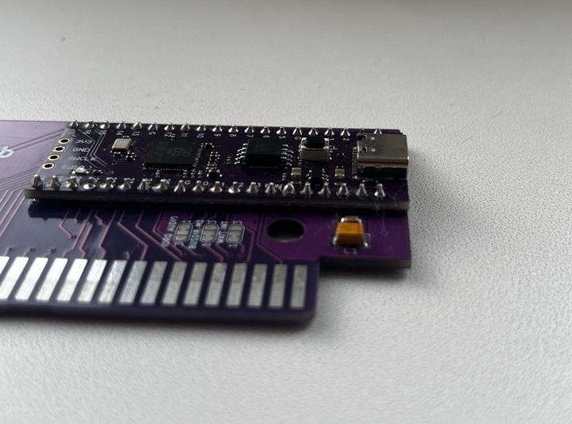

# OmniSCC — MSX MultiCart

OmniSCC is an RP2040-based MSX cartridge that loads ROM and floppy disk images
from the Pico's 16 MB flash. It emulates plain and mapped ROM cartridges, the
Konami SCC sound chip, and floppy drives backed by `.dsk` files.

When powered from USB without the MSX, it appears as a removable drive for
copying images by drag-and-drop. On the MSX, the default Screen 5 menu browses
files and folders and remembers the last booted image. An alternative menu
provides ten configurable favourites.


*OmniSCC — a 16 MB "purple" Pico clone soldered directly onto the carrier
board.*

---

## Contents of this repository

| Path | What it is |
|------|------------|
| [`firmware/`](firmware/) | Prebuilt firmware images. |
| [`tools/`](tools/) | Menu ROMs, and MSX-DOS utilities. |
| [`src/`](src/) | RP2040 firmware (C11 / C++17) + the Z80 side (`msx/preloader.asm`, `msx/loader.asm`, `msx/loader_fav.asm`). See [`src/README.md`](src/README.md). |
| [`Board/OmniSCC/`](Board/OmniSCC/) | KiCad project for the base board: schematic, PCB, 3D STEP, fabrication ZIP. |
| [`Board/OmniSCC+/`](Board/OmniSCC+/) | KiCad project for the level-shifted board. |
| [`enclosure/`](enclosure/) | SolidWorks parts and printable 3MF files for the case. |
| [`images/`](images/) | Board photos used by this file. |

Two git submodules are used, so clone with:

```bash
git clone --recursive https://github.com/<your-fork>/omniscc.git
# or, in an existing clone:
git submodule update --init --recursive
```

---

## Hardware variants

Both boards run the same firmware sources; they differ only in the board header
selected at build time (`-DPICO_BOARD=omniscc` or `omniscc_plus`).

### OmniSCC (base)



*The Pico module is soldered flat against the carrier board along both pin
rows.*

The Pico drives the MSX bus directly at 3.3 V. Fewest parts, lowest cost. Three
3-pole solder jumpers pick what reaches the Pico on GP26–GP28:

| Jumper | Choice | Required setting for this firmware |
|--------|--------|------------------------------------|
| `IORQ` / `AUDIO` | GP26 | **AUDIO** — GP26 is the SCC PDM audio output. |
| `BUSDIR` / `M1` | GP27 | **BUSDIR** — the firmware never reads `/M1`. |
| `WAIT` / `INT` | GP28 | **WAIT** — the loader stretches every bus cycle with `/WAIT`. |

### OmniSCC+


*OmniSCC+ — same Pico module, plus SN74LVC8T245 bus transceivers for
proper 5 V level translation.*

Address, data and control lines run through level shifters, so the MSX sees
real 5 V logic. There are no option jumpers: GP26 is AUDIO, GP27 is the data
transceiver direction (`DATA_DIR`), GP28 is `/WAIT`. Build with
`-DPICO_BOARD=omniscc_plus`, which defines `WITH_SHIFTERS`.

---

## Quick start

1. **Flash the firmware.** Hold **BOOTSEL**, plug into USB, release; copy a
   `.uf2` to the `RPI-RP2` drive. Pre-built images live in
   [`firmware/`](firmware/) — `OmniSCC.uf2` for the base board,
   `OmniSCC+.uf2` for OmniSCC+. To build your own, see
   [`src/README.md`](src/README.md).
2. **Fill the drive.** Plug the cart into USB with the MSX powered off. A
   removable drive named `OmniSCC` appears (the first boot formats the flash and
   writes `WELCOME.TXT`). Copy [`tools/loader.rom`](tools/loader.rom)
   and your `.rom` files to its root. To build the menu yourself, see
   [`src/README.md`](src/README.md).
3. **Nothing to configure.** The menu lists what is on the drive and writes
   `/loader.ini` itself when you boot something. Write it by hand only to set a
   countdown or a title before the first boot:

   ```ini
   delay=3000
   scc_on_exit=1
   name=gradius.rom,Gradius
   ```

   For the ten-favourites menu, copy
   [`tools/loader_fav.rom`](tools/loader_fav.rom) to the drive
   **as `loader.rom`** and use `favN=` entries in `loader.ini`; see
   [`src/README.md`](src/README.md#which-menu-rom-to-copy).
4. **Eject, plug into the MSX, power on.** The menu appears; it auto-boots
   whatever you booted last when the countdown runs out.

### Menu keys

| Key | Action |
|-----|--------|
| Cursor up / down | Move the highlight; the list scrolls at the edges |
| Cursor left / right | Page up / page down |
| `RETURN` | Enter a directory, or boot a file |
| `BS` | Up one directory |
| `SPACE` | Put the highlighted `.dsk` in drive B, or take it out again |
| `ESC` | Leave the menu for BASIC (maps a bare SCC cartridge first if `scc_on_exit` is non-zero) |

Any keypress cancels the auto-boot countdown for the rest of the session.

### Floppy drive emulation

The cartridge serves `.dsk` files on its USB volume as floppy drives to the
MSX. Select an image in the browser menu to mount it as drive A; the MSX then
resets and boots through the emulated Disk ROM. Press `SPACE` on another `.dsk`
first to put it in drive B. The browser saves that choice as `disk2=` in
`loader.ini`. You can also set `disk2=` by hand. Whether B: appears to the MSX
depends on the Disk ROM's own drive count; some dumps advertise only A:.

You must supply your own **16 KB MSX Disk ROM dump**; none is distributed with
this project. Copy it to the USB volume as `disk.rom`, or set `diskrom=<path>`
in `loader.ini` to use a different file. The firmware patches a copy of the
dump in RAM when mounting a disk and leaves the file untouched. A dump must
pass the firmware's validation, so an arbitrary 16 KB ROM will not work.
Please not at the developing stage two kind of roms are tested and proved 
to work:
- yis805-128r2_disk.rom (MD5: 814aad415b58cc3f78c7b571512b2006) 
- NATIONALDISK.rom (MD5: 86269da485e852d9f581ac27f4ba32ff)

Images are **writable**: MSX-DOS and Disk BASIC can save files directly into
the `.dsk` on the cartridge's flash. Set an image file's read-only attribute
on the USB volume to make the emulated disk write protected. `CALL FORMAT`
initializes a 360 KB or 720 KB image on either drive. SCC audio remains
available while a disk is mounted.

The firmware accepts any non-empty image whose size is a multiple of 512
bytes; it does not validate the disk's filesystem or geometry when mounting.
Standard 360 KB and 720 KB images work with the supported Disk ROMs. Other
sizes may mount, but Disk BASIC or MSX-DOS may fail when reading them, and
`CALL FORMAT` supports only the two standard sizes.

After booting a disk, you can change images without rebooting. For example,
`CALL MOUNT("B:SIDE-B.DSK")` inserts an image into drive B and `CALL EJECT("B:")`
removes it. `CALL DISK` reports both drives; `CALL DIR("GAMES")` lists disk
images on the cartridge's USB volume.

The same outer-volume also supports file management from BASIC:

```basic
CALL ODEL("OLD.DSK")
CALL OCOPY("SOURCE.DSK","BACKUP.DSK")
CALL ONEW("EMPTY.DSK")           ' 720 KiB formatted FAT12 image
CALL ONEW("SINGLE.DSK",360)      ' 360 KiB formatted FAT12 image
```

`ODEL` refuses an image mounted in drive A or B. `OCOPY` and `ONEW` never
overwrite an existing file, and copy transfers preserve every source sector.
New images are empty FAT12 images and are not mounted automatically. Paths are
literal `.dsk` paths on the cartridge volume; subdirectories and spaces are
supported.

The matching MSX-DOS programs are `MOUNT.COM`, `EJECT.COM`, `DISK.COM`,
`ODIR.COM`, `ODEL.COM`, `OCOPY.COM` and `ONEW.COM`; copy them into a DOS image
before use. See the [Disk BASIC command guide](src/README.md#disk-commands-from-basic)
and [MSX-DOS command guide](src/msx/dos/README.md) for syntax, protocol limits
and error handling.

---

## Supported mappers

Detected automatically from the ROM contents: plain/linear, Konami (8 KB
pages), Konami SCC, ASCII8, ASCII16. Detection can be overridden by putting
`[Plain]`, `[Konami]`, `[KonamiSCC]`, `[ASCII8]` or `[ASCII16]` in the filename
before the extension.

The SCC is emulated on core 1 and rendered as a PDM stream through PIO + DMA on
GPIO 26. A bare SCC cartridge with no ROM can also be mapped from the menu (just 
exit to basic), for software that expects an SCC to be present but supplies its 
own code.

ROMs up to 128 KB are cached in RAM; larger ones are staged into a 1 MB region
of the Pico flash and read from there.

---

## Enclosure

[`enclosure/`](enclosure/) contains ready-to-print 3MF file: `carts.3mf`. 
Fill free to remove non required parts in the slicer.

---

## Documentation

- [`src/README.md`](src/README.md) — building, flashing, `loader.ini`
  reference, mapper tags, troubleshooting.
- [`src/docs/omniscc_api.md`](src/docs/omniscc_api.md) — the Z80↔Pico
  command protocol, for writing your own MSX-side software.

---

## IMPORTANT!
The RBSC provides all the files and information for free, without any liability. 
The provided information, software or hardware must not be used for commercial purposes unless permitted by the RBSC.
Producing a small amount of bare boards for personal projects and selling the rest of the batch is allowed without the permission of RBSC.
When the sources of the tools are used to create alternative projects, please always mention the original source and the copyright!

---

## Contact information

The members of RBSC group Tnt23, Wierzbowsky, Pyhesty, Ptero, GreyWolf, SuperMax, VWarlock, ALSP and DJS3000 can be
contacted via the group's e-mail address:

info@rbsc.su

The group's coordinator could be reached via this e-mail address:

admin@rbsc.su

The group's website can be found here:

https://rbsc.su/
https://rbsc.su/ru

The RBSC's hardware repository can be found here:

https://github.com/rbsc

The RBSC's 3D model repository can be found here:

https://www.thingiverse.com/groups/rbsc/things

-= ! MSX FOREVER ! =-
