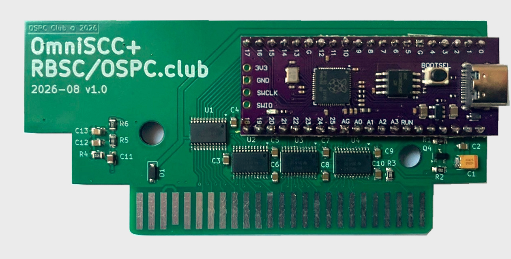
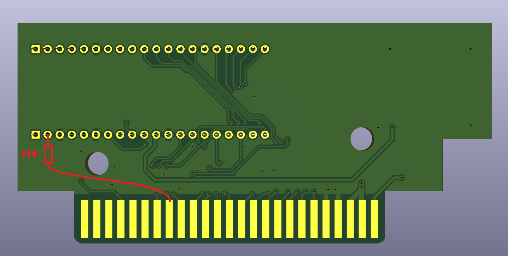

# OmniSCC+ — level-shifted board

KiCad 8 project for OmniSCC+: the same 16 MB Raspberry Pi Pico clone, but with
SN74LVC8T245 bus transceivers between the RP2040 and the MSX slot, so the MSX
sees proper 5 V logic levels on the address, data and control lines.

## Revision 1.1

R7 (10 kΩ, 0805) pulls `/RES` up to `+5VA`. This hardware change addresses
spontaneous resets observed in USB mode when touching the connector on revision
1.0. Use the revision 1.1 PCB and fabrication archive for new boards.

## USB stability fix for revision 1.0

Revision 1.0 has no pull-up resistor on `/RES`. The floating reset signal can
cause spontaneous resets in USB mode, for example when touching the USB
connector. Add a **10 kΩ resistor between `/RES` and `+5VA`** to retrofit the
pull-up included as R7 on revision 1.1.

1. Disconnect the board from both the MSX and USB before soldering.
2. With the board oriented as in the picture, solder the 10 kΩ resistor and
   connecting wire between the two marked points. The resistor has no polarity.
3. Insulate the resistor lead and wire where needed so they cannot short to
   neighbouring pads or the cartridge edge contacts. Check the solder joints
   and reconnect USB to verify stable operation.

This is a hardware modification; changing the firmware alone does not add the
pull-up. Revision 1.1 already includes R7 and needs no additional resistor.

## Files

| File | Contents |
|------|----------|
| `OmniSCC+.kicad_sch` / `.kicad_pcb` / `.kicad_pro` | Schematic, layout, project |
| `production/OmniSCCplus_1_1_Gerber.zip` | Revision 1.1 Gerbers and drill files (no BOM/CPL) |
| `production/netlist.ipc` | Revision 1.1 IPC-D-356 netlist for electrical test |
| `fabrication-toolkit-options.json` | KiCad Fabrication Toolkit settings used to generate the ZIP |
| `Datasheets/OmniSCC+-v1.0-schematic.pdf` | Historical revision 1.0 schematic; use the KiCad schematic for 1.1 |
| `Datasheets/RPPICOPURPLE-pin-1024x438.jpg` | Pinout of the 16 MB Pico clone |
| `../../LICENSE` | Project license |

The old `production/OmniSCCplus_1_0_Gerber.zip` and `production/v1.0/` assembly
CSVs are retained for revision 1.0 only. They must not be used to assemble 1.1:
component positions changed and R7 was added. Generate new assembly exports
from the revision 1.1 KiCad project when needed.

Symbols and footprints come from the OSPC library
([OSPC_Library](https://github.com/VWarlock/OSPC_Library)); configure it before
opening the project.

## Differences from the base board

- Level shifters on the whole bus instead of a direct 3.3 V connection.
- No option jumpers. GP26 is `AUDIO`, GP27 is the data transceiver direction
  (`DATA_DIR`), GP28 is `/WAIT`. `/IORQ`, `/BUSDIR`, `/M1` and `/INT` are not
  routed to the RP2040.

Build the firmware for this board with `-DPICO_BOARD=omniscc_plus`, which
defines `WITH_SHIFTERS`.
