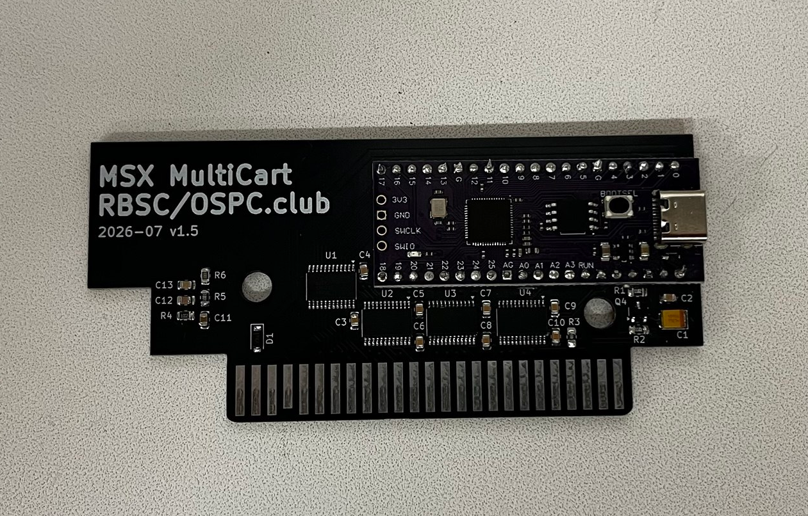

# OmniSCC+ — level-shifted board

KiCad 8 project for OmniSCC+: the same 16 MB Raspberry Pi Pico clone, but with
SN74LVC8T245 bus transceivers between the RP2040 and the MSX slot, so the MSX
sees proper 5 V logic levels on the address, data and control lines.

## Files

| File | Contents |
|------|----------|
| `OmniSCC+.kicad_sch` / `.kicad_pcb` / `.kicad_pro` | Schematic, layout, project |
| `production/OmniSCC_1.0.zip` | Gerbers + drill + BOM/CPL for fabrication |
| `production/netlist.ipc` | IPC-D-356 netlist for electrical test |
| `fabrication-toolkit-options.json` | KiCad Fabrication Toolkit settings used to generate the ZIP |
| `Datasheets/OmniSCC+.pdf` | Schematic as PDF |
| `Datasheets/RPPICOPURPLE-pin-1024x438.jpg` | Pinout of the 16 MB Pico clone |
| `LICENSE` | GNU GPL v3 |

Symbols and footprints come from the `Board/libs` submodule
([OSPC_Library](https://github.com/VWarlock/OSPC_Library)); initialise it before
opening the project.

## Differences from the base board

- Level shifters on the whole bus instead of a direct 3.3 V connection.
- No option jumpers. GP26 is `AUDIO`, GP27 is the data transceiver direction
  (`DATA_DIR`), GP28 is `/WAIT`. `/IORQ`, `/BUSDIR`, `/M1` and `/INT` are not
  routed to the RP2040.

Build the firmware for this board with `-DPICO_BOARD=omniscc_plus`, which
defines `WITH_SHIFTERS`.
