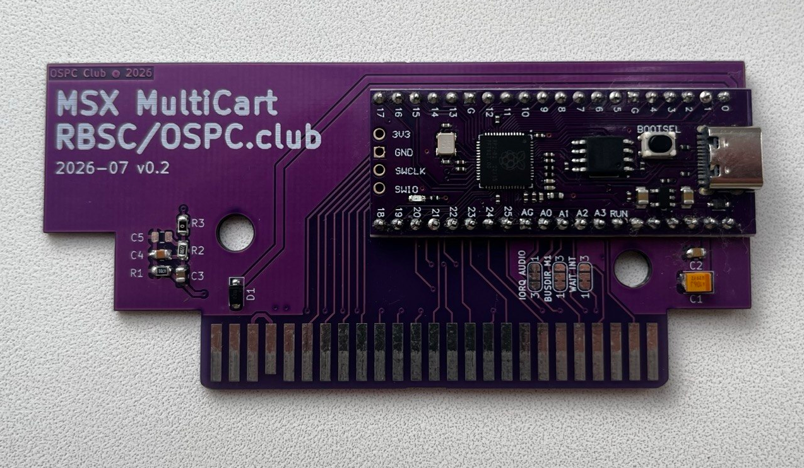

# OmniSCC — base board

KiCad 8 project for the base OmniSCC carrier: a 16 MB "purple" Raspberry Pi
Pico clone soldered flat onto an MSX cartridge edge connector, with no level
translation — the RP2040 drives the MSX bus directly at 3.3 V.

## Files

| File | Contents |
|------|----------|
| `OmniSCC.kicad_sch` / `.kicad_pcb` / `.kicad_pro` | Schematic, layout, project |
| `3D/OmniSCC.step` | 3D model of the assembled board |
| `production/OmniSCC_1.0.zip` | Gerbers + drill + BOM/CPL for fabrication |
| `production/netlist.ipc` | IPC-D-356 netlist for electrical test |
| `Datasheets/OmniSCC-v1.0.pdf` | Schematic as PDF |
| `Datasheets/RPPICOPURPLE-pin-1024x438.jpg` | Pinout of the 16 MB Pico clone |

Symbols and footprints come from the `Board/libs` submodule
([OSPC_Library](https://github.com/VWarlock/OSPC_Library)); initialise it before
opening the project.

## Option jumpers

Three 3-pole solder jumpers choose what reaches GP26–GP28. The firmware in
[`firmware/`](../../firmware/) expects:

| Jumper | Selects | Set to |
|--------|---------|--------|
| `IORQ` / `AUDIO` | GP26 | **AUDIO** — SCC PDM audio output |
| `BUSDIR` / `M1` | GP27 | **BUSDIR** — `/M1` is unused |
| `WAIT` / `INT` | GP28 | **WAIT** — the loader stretches bus cycles |

Build the firmware for this board with `-DPICO_BOARD=omniscc` (the default).
